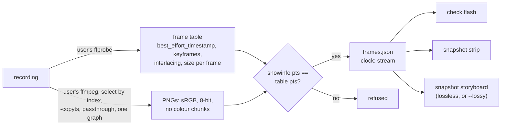

# scan video v1 — recordings through the user's own decoder

2026-10-13. `vlmkit scan video` decodes a recording (mp4, webm, mov, mkv, gif, apng, …) into a
`vlmkit-frames/1` sequence with **the user's own ffmpeg and ffprobe**, and `check flash rec.mp4`
judges a recording for WCAG 2.3.1 with no page at all. This round is what six measurement agents
established about ffmpeg 6.1.1 and Chromium 141 / 149 before the code was settled. It also covers
what an adversarial review of the first version found (54 findings), what changed for each, the
known answers the tests hold, and what it costs.

## Why

`check flash` judged pages only. On a page, a `<video>` is paused and reported unmeasured, and an
animated GIF runs on the browser's clock and is reported the same way. So the content most likely
to flash, a clip or a looping GIF, was the content it could not judge. A recording's frames are
also what `snapshot storyboard` and `snapshot strip` could use, and the research that ordered this
work put "external video files through a decoder the user supplies" next after `check flash`.

## The decoder is the user's

vlmkit ships, depends on and downloads none. ffmpeg-static 5.3.0 is GPL-3.0-or-later and downloads
an 80 MB binary, and imageio-ffmpeg ships the same binary. ffprobe-static is labelled MIT but ships a
GPL build. Playwright's private `ffmpeg-1011` is a versioned internal artifact with VP8 and MJPEG
decoders only. `scan video` spawns the binaries the user has:
- `--ffmpeg` / `--ffprobe`;
- `VLMKIT_FFMPEG` / `VLMKIT_FFPROBE`;
- the ffprobe beside ffmpeg, or beside what a symlink points to;
- otherwise `PATH`, resolved by vlmkit itself.

They run as processes with arguments, never through a shell, and are killed if vlmkit is. Any other
decoder can write numbered PNGs and one timestamp per line, which `scan video <dir> --pts` imports.

## What was measured

### Which frames, and when (15 inputs)

| Measured | Consequence |
|---|---|
| With `-copyts` and `-fps_mode passthrough`, ffprobe's decoded frame list matched ffmpeg's written PNGs one to one, in presentation order. Inputs: x264 with B-frames, VFR mp4 and mkv, an edit-list cut, `-itsoffset`, mpegts, a mid-GOP start, duplicate pts, VP8 with a hidden alt-ref, VP9 superframes, GIF, APNG | The frame table is ffprobe's `best_effort_timestamp`, in integer ticks |
| Packet counts and `nb_frames` are not frame counts: the cut has 90 packets for 75 frames, VP8's alt-ref 91 for 90, WebM says N/A | Counts come from decoded frames only |
| Without `-fps_mode`, image2 goes CFR (2 selected frames became 214 files; VFR input gave dup=4 drop=3). `vfr` and `cfr` drop frames that share a pts. Output-side `-frames:v` / `-t` make showinfo print frames that are never written | Always passthrough; frames chosen by `select` on the decoded index |
| Without `-copyts`, every timestamp shifts by the *format* start_time, which is not the first shown frame's (a mid-GOP mpegts started at 0.5s) | `-copyts`; showinfo's pts then equals ffprobe's exactly |
| showinfo's `pts_time` has 6 significant digits (10ms steps past 1000s), and frame durations are unreliable (missing on VFR mp4, 0 in showinfo, 1ms on every mkv frame) | Integers only; a frame lasts until the next one's pts |
| `-ss` takes the next frame (ceil); Chromium shows the floor frame (72 of 72 instants) | `--at t` is the last frame that began at or before t; `-ss` is never used |
| Chromium's `currentTime` is the stream's own timeline: a video offset by 0.7s shows frame 9 at 1.0s | `atMs` is on that timeline, not counted from the first frame |
| Frames that share a timestamp exist (0, 0, 0, 33ms) | Only the last is on screen; the others are counted as `hidden` |
| A raw elementary stream has no timestamps (ffprobe's keys are absent) | Refused, with a lossless re-encode at its rate (a stream copy cannot time reordered B-frames) |

### Colour

| Measured | Consequence |
|---|---|
| ffmpeg 6.1's own conversion honours a tagged matrix and range: four methods gave byte-identical PNGs | Tags are used as tagged |
| Untagged, ffmpeg assumes BT.601 limited at every size. Chromium does the same for VP9 at every size, but guesses BT.709 for untagged H.264 from 720 lines up. ffmpeg's default 720p output and Playwright's recordVideo (VP8) are BT.601 data with no tags, and Chrome shows the 720p H.264 one 39 levels off | Untagged is BT.601 limited, recorded as assumed; `--color-matrix` / `--color-range` override |
| A wrong matrix flips a verdict: an untagged BT.709 `#00ff00`/`#00d700` strobe (ΔL 0.229) passes read as BT.601, where green clips and ΔL becomes 0.019 | `flash-video.test.ts` holds both readings |
| Default swscale rounding errs by 2 levels (3 on 10-bit); `accurate_rnd+full_chroma_int` errs by at most 1 (0 on 10-bit); `accurate_rnd` alone is worse than the default (808080 → 7e7e7e) | The scale carries both flags |
| ffmpeg's PNG encoder copies the stream's tags into cICP / cHRM / gAMA, and an ICC profile into iCCP; Chromium colour-manages them (grey 808080 shown as 8c8c8c, a SMPTE-170M frame shifted 63 levels). vlmkit's decoder reads the bytes | `setparams=…=unknown` and `sidedata=…ICC_PROFILE` after `format=rgb24` (before it, the matrix falls back to BT.601) |
| PQ and HLG pass through as code values (100-nit white ≈ 130/255) | HDR refused, with a tone-map recipe |

### Edges (synthetic files per case)

| Measured | Consequence |
|---|---|
| ffmpeg autorotates; ffprobe's `rotation` misdescribes a mirrored display matrix; an odd angle gets black corners | Autorotate kept, rotation recorded, an odd angle noted |
| SAR is not applied when writing PNGs; a bicubic resize in YUV blended a red/blue edge | Resampled square after RGB, nearest, expanding (SAR 1:2 → taller, as Chromium shows it) |
| Interlaced frames decoded plainly are woven: a 50-field black/white strobe became 25 identical combs. bwdif misses it too | `separatefields` plus line doubling, at twice the frame rate |
| `format=rgb24` drops alpha and shows the colour stored under transparent pixels: hidden toggles became a full-field flash, and a visible one was hidden. VP8/VP9 alpha is only in a tag, and only libvpx decodes it | Composited over `--background` (white default) by premultiplying, which keeps timestamps; libvpx chosen for a WebM's alpha |
| A truncated faststart mp4 decodes 36 of 75 frames and exits 0 | The decoder's error lines are kept in `source.video.decodeErrors` |
| `-map 0:v:0` can pick a one-frame cover track; ffmpeg's own choice takes a larger non-default stream over a smaller default one | The stream the file marks default, else the largest, mapped by absolute index; cover art excluded (not ffmpeg's rule, said so) |

### PNG output

| Measured | Consequence |
|---|---|
| ffmpeg's PNGs are lossless (6,990 of 6,990 frames byte-identical to raw rgb24), and vlmkit's fast decoder reads every 8-bit RGB/RGBA file ffmpeg writes | — |
| Unfiltered rows read 3-7x faster than sub/up/paeth; level 1 writes about 2x faster than the default 6, for 13-27% larger files; level 0 is raw-size and no faster to read | `-pred none -compression_level 1` |
| showinfo's default checksums doubled a 1080p decode | `showinfo=checksum=0` |
| Without an explicit `format=rgb24`, 10/12-bit, gray and pal8 sources write PNGs that send vlmkit to pngjs (about 4x slower) | Always `format=rgb24` |

### GIF and APNG in a browser

| Measured | Consequence |
|---|---|
| Chromium 141 and 149 hold any frame of 10ms or less for 100ms, on the integer ms (an APNG 1/95s frame is held 100ms) | Delays read from the bytes and clamped the same way |
| ffmpeg gives a GIF's 1cs frame 10ms and an APNG's 0 delay 1/15s, and its demuxer's delay options changed nothing | ffmpeg's timing is not used for them |
| ffmpeg decodes one pass; Chromium loops (NETSCAPE2.0 or ANIMEXTS1.0; a loop count of N plays N + 1 times). A two-frame black/white GIF at 100ms a frame is 5 flashes a second on screen and 1 transition in one pass | Unrolled as far as the selection reaches; by default to the frame on screen a second past one pass |
| ffmpeg's GIF demuxer merges an image with no graphic control extension into the one before; Chromium shows both | Refused, with a recipe through import |

### Lossy recordings and check flash (105 runs)

| Measured | Consequence |
|---|---|
| Full-field strobes (5 Hz fail, 2 Hz pass), the large red box, near-threshold greys (ΔL 0.1034 fails, 0.0946 passes), a static UI page and scrolling text gave the lossless verdict at crf 23/35/45 and Playwright's VP8, at 25/30/60fps | No noise floor for check flash |
| Flat-area codec noise stays within 0.036 of the previous frame; keyframes move text edges by 0.45-0.9, about once a second | — |
| A two-frame GOP at crf 45 made dense static text fail on its own (26,119 px²) | A failing lossy stream with more than 3 keyframes a second is said to be able to pump |
| 4:2:0 alone took the 1px rim off a red/black box (21,904 → 21,316 px², fail → pass); ringing grew a black/white one (+3.3% at crf 45) | Within 5% of the limit, a lossy or subsampled verdict is "not decisive" |
| A 148x148 red/black strobe passed the red track at crf 35 (16,385 px²) and 45 (153 px²): black decodes as (1,0,0)-ish, red's own chromaticity, so the move to red was no u′v′ step | `flash.ts` treats luminance ≤ 0.001 as black for chromaticity (0.0002 already restored both). The 144-test flash suite and the 38 fixtures are unchanged |
| At 25/30fps on the held clock, every pass carried `flash-undersampled`, and a 6fps pass was "unjudgeable" | The stream clock: a whole recording's frames are its content |
| Playwright's recordVideo is VP8, 25fps CFR, one keyframe, with a tail of a second or more | — |

## Known answers (tests)

- `video-decode.test.ts` (28 tests). Every synthetic stream encodes frame N as luma 16 + 7N, so each written frame is identified by its pixels. Cases:
  - B-frames in presentation order, keyframes every 10;
  - spans and instants on the floor rule;
  - a start offset of 1.25s on the stream's own timeline;
  - VFR at 0/100/120/420/460/500ms;
  - BT.709 red, with no colour chunk in the PNG;
  - `--display-width`;
  - refusals: audio only, junk, missing, HDR, `--max-frames`, `--stream`;
  - decoder lookup: PATH, an empty variable, ffmpeg 4.4 refused;
  - SAR 2:1 and 1:2, and full range with SAR;
  - alpha over white and black;
  - a 50-field strobe split into its fields;
  - a truncated file's errors;
  - a GIF without graphic control extensions refused;
  - a size change refused from the table;
  - a pixel-format change mid-stream with `select`;
  - coloured logs and metadata that mimics showinfo;
  - the output directory's safety;
  - import with shared timestamps;
  - GIF and APNG loops, clamps, and instants past the written passes.
- `flash-video.test.ts` (15). Cases:
  - a 5 Hz strobe fails and 1.5 Hz passes;
  - 6fps cannot fail;
  - a red strobe;
  - a still picture;
  - `--display-width` moves the area across the limit;
  - `check flash rec.mp4` equals `scan video` plus `check flash frames.json`;
  - the green matrix flip;
  - a looping GIF fails and the same GIF played once passes;
  - an interlaced field-rate strobe;
  - the lossy red box, "not decisive";
  - spans judged with their history, the window ending at `--from` included;
  - a thinned import is not a pass;
  - a frames directory;
  - an APNG named `.png`.
- `video-frames.test.ts`, `image-timing.test.ts`, `frames.test.ts`, `flash.test.ts` (the near-black red case), and `scan-video-cli.test.ts` (arguments; storyboard refuses lossy, and finds a planted glitch and transient in a lossless recording).

## What the review found

Six reviewers (decode pipeline, contract consumers, GIF/APNG, CLI and gate, robustness, docs) raised
54 findings. Every one came with a reproduction. Skeptics independently confirmed the first 27 they
reached, and that pass was stopped there. Five were already fixed by the measurement round: the SAR
step that squeezed full range, alpha (three findings) and iCCP. The rest:

| Finding | Fix |
|---|---|
| A `--from/--to` span was treated as the whole recording: a 0.5s span of a 5 Hz strobe passed, and windows crossing the span's edge were never judged | `check flash` decodes the second before the span and judges only windows ending inside it (`judgeFromMs`); a span without that second is `flash-undersampled` |
| A looping GIF was cut at its written passes: `--at` past them gave the last frame, `--from` past them was refused, and whole extra passes doubled long GIFs | Unrolled as far as the selection reaches; the default stops a second past one pass |
| A GIF whose images ffmpeg merges fell back to ffmpeg's timing and passed a 5 Hz strobe; ANIMEXTS1.0 was ignored; APNG delays were not whole ms | Refused; both loop blocks read; delays floored |
| Imports were always "complete": a `-vf fps=5` export of a strobe passed | Complete only with `--every-frame`; shared timestamps hidden as `scan video` hides them |
| A filter rebuild restarted `select`'s count on a format change | `-reinit_filter 0`, with size changes refused from the table, since that graph rescales silently |
| showinfo was matched anywhere in stderr (metadata injected frames) and broke on `AV_LOG_FORCE_COLOR` | Its own prefix only; colour off and stripped |
| ffmpeg below 5.1 failed every file as if the file were bad; Windows ran `ffmpeg.exe` from the working directory; symlinked ffmpeg lost its ffprobe; an empty variable crashed; a killed run orphaned ffmpeg | Version refused by name; PATH resolved by vlmkit; realpath sibling; empty is unset; children killed |
| The output directory was cleared before decoding (a failed re-scan lost the good one), could delete the recording, took another tool's sequence, and `clip.mp4`/`clip.webm` shared one | Cleared after a checked decode, never the input, other tools refused, `rec.mp4.frames/` |
| An APNG named `.png`, a directory, and a page with `?clip=a.gif` were routed wrongly | Sniffed, judged by its `frames.json`, query ignored |
| SAR below 1 shrank frames; a tagged-but-unsupported matrix was called untagged; rpza was "lossless"; a huge `--display-width` crashed; a manifest without viewport crashed the report | Expanded; refused; removed; bounded at 4096; validated |
| Docs: "under 7fps nothing can fail" (6.5fps can), `index` documented as decoded position, the cited report missing, comments describing a rejected design | Corrected (this report) |

## What the second review found

A second round of six reviewers (span semantics, GIF/APNG against Chromium, the filter chain,
decoder process and file safety, CLI and gate, docs) raised 39 findings, each with a reproduction;
four were duplicates of another. All are fixed, each held by a test:

| Finding | Fix |
|---|---|
| The judge evaluated a window only where a transition landed, so the window ending at `--from` was never judged: a strobe stopping just before `--from` passed (`--from 1.6s` on the burst; a crf 23 H.264 strobe) | The first judged window is judged whether or not anything transitions on it, every pixel's count raised into the peak (`openAt`); a start between frames, or past the last, too |
| A complete span of a 6fps recording was NOT JUDGEABLE (exit 1) where the whole recording passed | `coverage.complete` decides, not `whole` |
| A span's one second of history started every pixel cold: a 0 → 0.06 → 0.12 step before a strobe lost a transition (false pass), and a leg counted before the window counted again (false fail) | `SPAN_HISTORY_MS` 3s; a verdict that one transition decides says the span was counted from that history (`report.history`); a history from the start is exact |
| `--from` without `--to` on a looping GIF was refused with "9007199254740991ms" (three reports) | No `--to` is carried as none: a video to its end, a loop a pass and a second past `--from` |
| `--from` inside the last frame's display time was "after the recording's last frame" | Allowed to the recording's end (`recordingEndMs`) |
| GIF disposal to background with no transparent index, and a first image smaller or larger than the logical screen, are composited by ffmpeg otherwise than by Chromium (a false pass and a false fail) | Refused (`gifCompositingProblem`) with an ImageMagick coalesce + pts recipe |
| An APNG named `.png` with a first frame over 1 MiB, or a large text chunk first, was not sniffed (three reports) | Chunk headers walked to `acTL` (`apngDeclaredFrames`) |
| A GIF's aspect byte and a PNG's pHYs were applied as SAR (a 120x120 strobe judged at 240x120) | Not applied to images |
| An APNG with more `fcTL` than its `acTL` declares played the extras | The declared frames, as Chromium plays them |
| Interlaced + SAR: the line-doubling doubled the SAR (NTSC DV came out 1280x480; a PAL box failed at twice its area) | `setsar=r=sar/2` after the doubling |
| The field split was decided by the stream's tag and the first 30 frames: a stream turning interlaced later stayed woven (strobe passed); progressive frames under a `tt` tag were split (1px stripes failed) | Per frame, by each frame's flag, in one decode with two named graphs; the tag decides only for codecs that flag nothing |
| Interlaced + rotation: autorotate turned the frame before the split (90° split columns, 180° reversed the fields) | `-autorotate 0` and ffmpeg's own mapping applied after the split (`rotationFilters`) |
| Grey (AV1 4:0:0, HEVC RExt) was read as full-range RGB; `--color-range` ignored | Luma: through `format=yuv444p`, since swscale's grey → RGB applies no range |
| Decode errors by keyword: a truncated WebM (`File ended prematurely`) and HEVC damage had none, and a path or title with "corrupt" / "Truncated" had one | By level (`-loglevel level+info`), error or worse, demuxer and decoder only; frames ending well before the stated duration noted |
| The reaper's signal listeners stayed installed, so Ctrl-C did nothing during a minute-long judge | Listeners only while a decoder runs |
| A recording named like frame 0 was overwritten by it (the old test checked existence only), and a symlinked `--out` unlinked one | Refused up front, on realpaths; the test compares bytes |
| Two scans into one directory deleted each other's work dirs | A lock file naming the live scan; a dead one's taken over |
| `onPath` took non-executable files, `./` resolved in the working directory, npm shims and `.cmd` on Windows, quoted entries missed | Absolute entries only; X_OK on POSIX; `.com` / `.exe` on Windows, unquoted |
| An interrupted `check flash` left its decoded frames in the temp dir | Pid-named, swept by the next run |
| An import overwrote another tool's `frames.json`, which then let a decode clear its frames | Refused |
| `check flash <dir>` dropped `--window` / `--frames` / `--viewport`; `--out` naming a file crashed with EEXIST after the whole probe | Refused as for a `.json`; checked before decoding |
| The help's import recipe decoded one stream and timed it by another, then `--every-frame` backed a false pass | Both halves name `v:0` |
| The "not decisive" note missed nv12, 4:2:2 and other subsampled formats | `chromaSubsampled` reads the layout |
| Stale comments (fieldOrder "decoded as frames", `atMs` "from the first frame", colour "notes"), the CLAUDE.md grating clause, the storyboard line in the help, BLACK_BELOW_Y's (15,0,0) | Corrected |

## Cost (this sandbox, 4 cores)

- `scan video`, 10s 720p H.264: 3.4s for flat UI-like content (6 MB of PNGs) and 4.6s for `testsrc2` (77 MB).
- `check flash` on the same files: 11.7s for the static UI and 106s for `testsrc2`. Most of that is the per-pixel count, plus the motion re-count where the pattern fails.
- The frame table costs one extra decode. ffprobe's `-show_frames` decodes the stream; on 1800 frames at 720p that was 4.5s, against 67ms for a packet list. Packets were not used because they miscount (VP8's alt-ref).

## Limits, said so

- Only ffmpeg 6.1.1 was measured. 5.1 is the floor because of `-fps_mode`, and a git build is taken as new.
- Browser timing was measured in Chromium only, not Firefox or Safari.
- HDR is refused, not judged.
- A 1D grating whose bars are a 16px block wide or more, moving across, reads as flash even losslessly. A block inside a bar is flat, so nothing matches its motion. This was found here and is in the motion re-count; the docs that claimed such gratings read as motion now say which do.
- A recording's area depends on how wide it plays (`--display-width`); one frame pixel per CSS px is only the default.
- A span is counted from 3 seconds of history, not the whole past. A pixel in one slow change through all of them can count one transition differently from the whole recording, and a verdict that one transition decides says so.
- A GIF that ffmpeg composites otherwise than a browser is refused, not judged. The recipe writes it through ImageMagick, one pass, without the loop's seam.
- A storyboard of a lossy recording has no noise floor yet. That is the next item in the research's order.
