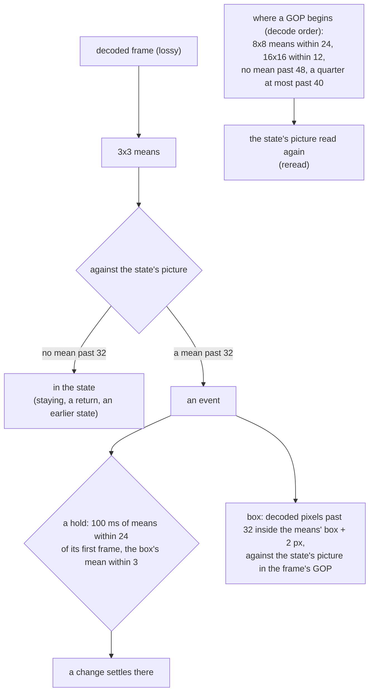

# storyboard noise floor v1 — lossy recordings through a noise band

2026-10-16. `snapshot storyboard --lossy` compares frames decoded from a lossy codec through a
noise band instead of byte for byte. This round covers:

- how the band was chosen, on known answers;
- what two adversarial reviews and the bench found wrong with the first design, and what replaced it;
- what a second review of that redesign found, on 375 cases of its own, and what changed again;
- what it does on real recordings with labels;
- what it still cannot see.

## Why

`scan video` (2026-10-13) made recordings readable, but the storyboard compared pixels exactly. A
codec does not give back the picture it was given: the same still screen decodes differently from
one frame to the next, most of all at sharp edges and across a keyframe. On the H.264 desktop
recordings of ServiceNow's VideoCUA, 9 of 562 consecutive frame pairs were byte-identical. So the
storyboard reported one change that began at frame 1 and never settled. The labelled-dataset survey
that came before this round found the same on every real recording it tried. So the second stage of
"scan video → storyboard → the agent reads the keyframes" could not be scored on real video at all.

## Known answers

`fixtures/storyboard/planted-ui.html` plants the kinds of `planted.html` on a page that looks like
an application, so a codec has something to ring around: text in three sizes, a photo-like seeded
texture, a gradient, a table. It also adds four kinds a screen recording shows:

- a 1px text-field caret blinking;
- a digit in 12px text changing (`Items 12` → `Items 13`);
- a pointer moving;
- an article scrolling 1px a frame.

Each was captured lossless on the held clock (61 frames, 640x400), and its lossless storyboard is
the answer. All eleven gave the planted events.

The 18 captures (11 on the UI page, 7 on the plain one) were encoded at 60fps with 14 encodings:

- x264 at crf 18, 23, 28, 35 and 45;
- x264 crf 28 with a keyframe every 10 frames;
- x264 crf 23 at 4:4:4;
- x265 crf 28;
- VP8 as Playwright's recordVideo writes it;
- VP9 at crf 31 and 50, each with a keyframe every 30 frames;
- AV1 (SVT) at crf 35 and 50;
- MJPEG.

Each encoding was decoded by `scan video`, giving 252 cases. Two sets were added during the round:

- 30 harsher encodes the first review made: 1s GOPs at crf 23-35 with the event at the stream's
  end; toasts and blinks at five offsets from a 10-frame GOP's keyframes; a long toast across GOPs;
  still pages at crf 28 and 35.
- 12 encodes the bench needed: six UI kinds through x264 crf 28 at one keyframe a frame
  (intra-only) and at a keyframe every two frames.

A case counts as right only when, event for event, the lossy storyboard matches the lossless one:

- the same class (a return or a change);
- beginning within 3 frames;
- ending no earlier than a frame before and no more than 12 frames after (a codec blurs a change
  in over several frames);
- the same number of states, and no extra events.

The box is scored apart, as IoU against the lossless box.

## What the noise is

Measured between decodes of frames that were byte-identical when captured:

| | raw pixel | 3x3 mean | 4x4 block mean | 8x8 block mean |
|---|---|---|---|---|
| x264 crf 18-35, still text, between keyframes | up to 64 | ~16 | ~9 | ~2-4 |
| x264 crf 28, at a keyframe every 10 frames (the largest) | 142 | 36 | 26 | 14 |
| VP9 crf 50, at a keyframe | 5 | 3 | | |
| the digit change (signal) | ~148 | 53-71 | ~21 | 4-5 |

- The ringing is high-frequency, so a 3x3 mean cancels most of it while a glyph change survives.
  An 8x8 block mean loses the glyph.
- Keyframes are where the noise is largest, and they vary. With a 10-frame GOP the steps at the six
  keyframes were 36, 18, 23, 3, 10 and 36: two of them cross the floor. The review's crf 35 with a
  1s GOP moved means by up to 90, spread over the page.
- An intra-only stream is the opposite case. MJPEG decodes a still picture byte-identically, 61
  frames of 61. x264 at one keyframe a frame re-quantizes once, between its first two frames, as
  its rate control settles.
- Single-pair statistics could not choose the band, though. After a change, VP8's realtime mode
  keeps refining the picture for several frames, and that refinement reads as noise between frames
  the capture had as identical. So the band was chosen by running the storyboard itself.

## Choosing the band

An experimental copy of the storyboard with a pluggable comparison ran every case under 96 bands:
radius 0, 1 or 2; still 4-32; floor 8-64; floor ≥ still. These rows are from that copy, and none of
them has a keyframe rule:

| Band (radius, still, floor) | Right | What it got wrong |
|---|---|---|
| 1, 12, 32 | 205/252 | 28 fades; 9 crf 45; 9 at the 10-frame GOP's keyframes; a slide that never settled at crf 35 |
| 1, 24, 32 | 207/252 | 28 fades; 7 crf 45; 9 at the 10-frame GOP's keyframes; the digit on x265 crf 28 |
| 1, 24, 48 | 208/252 | 28 fades; 6 crf 45; 9 spinners read as back after 357° (a near-return within 48); the x265 digit |
| 2, 12, 24 | 195/252 | 28 fades; 7 crf 45; 14 spinners read as back; 5 drifts at keyframes; the digit on three encodings |

A floor of 48 absorbs keyframes but reads a spinner that has nearly come round as back. So the
floor stays 32, still 24 and radius 1, and keyframes need a rule of their own.

The first design, in the repo, gave a keyframe that departs from a still state, where the step into
it moves no mean past 48, a re-read of the state. It scored 215/252: 28 fades, 9 crf 45, and 208 of
the 208 cases outside those two limits. Without its keyframe rule it scored 206.

## What the reviews and the bench found

This section is the first round, as it was; the second review (below) replaced its "spread" keyframe
rule, its dating back of returns and the smear's reach, and the numbers after it are its own.

The first adversarial review (segmentation, numerics, CLI, performance, claims) reported 31
findings: 26 confirmed by a second agent trying to refute them, 5 in part. The ones that changed
the design:

- **Per pixel alone, a fade is a run of holds.** A hold was frames within `still` of its first
  frame. A fade slower than 24 levels per 100ms qualified at every frame, so one fade became
  one-frame drifts through made-up states, with shrunk boxes. A hold now also keeps the mean over
  the change's box within `holdMean` (3) of its first frame: a codec's noise cancels over a region,
  and a fade moves it. (The bench scored holdMean 2, 3 and 4 the same.)
- **A codec smears an instant change.** Steps inside `still` were dropped, so the digit, which x265
  crf 28 brings in over two frames, read as a drift. A step now reaches back `SMEAR_MS` (50ms); a
  unit test smears a change over four steps of 16.
- **The keyframe step band was wrong four ways.**
  - It swallowed real 33-48 level changes that landed on a keyframe.
  - It fired on the first frame of a fade or a fade-in toast, losing the fade or leaving a made-up
    state.
  - It never re-read a keyframe inside an event, so a transient across one became two changes.
  - x264 crf 35 with a 1s GOP stepped past 48 on a still page.

  It was replaced by a re-quantization test against the state's picture: no 8x8 block mean moved
  past 24 and no 3x3 mean past 96 (the review's crf 35 noise reaches 90). That test applies at a
  keyframe, at a return across a GOP, and at a change settling back into a state in a later GOP.
  The bench scored block 28 / pixel 112 the same as 24 / 96. Without the test the redesign scored
  199 of 208 and 12 of the review's 30.
- **A digit changing on a quiet keyframe is within the re-quantization band** (8x8 means move by
  4-5). At a keyframe the state is read again only when the noise is spread over a quarter of the
  frame's width and height, as a re-encoding's is.
- **A caret still on after a keyframe is within the band too.** A return across a GOP must be
  nearer the state than the event's own first frame, comparing 8x8 means inside the event's box.
- **Boxes and counts.** The decoded pixels were tested against the ignore mask grown for the means,
  which cut real change pixels beside an ignored box. The peak counted means while its box was
  drawn from decoded pixels.
- **`--noise` silently dropped the keyframe rule**, so `--noise 24,32` was not `--lossy`. And
  `--lossy` on a lossless capture silently raised its floor from 8 to 32. Now `--noise` carries the
  hold and keyframe bands, and `--lossy` on frames that are not lossy changes nothing and says so.
- **The look-ahead read whole frames of means.** After a small change, the 5s window computed
  full-frame means for each frame the signatures could not rule out (1042 of 1321 on a 720p
  recording). It now checks the departed box first, from the decoded pixels (`meansApartIn`).

The redesign scored 207 of 208 outside the limits and 29 of the review's 30. The bench of it then
found four more problems:

- **A run of keyframes is one GOP.** Every MJPEG frame is a keyframe; taken as GOPs, the scroll's
  first step was within the re-quantization band and spread, and read as the page re-encoded. A
  GOP now begins at a keyframe after a predicted frame. Inside a run of keyframes, a frame is read
  again only when the page then holds (x264's intra-only rate control).
- **Local keyframe noise crossing the floor.** Of the 430 GOP starts that could be measured (515
  in all; 85 had no frame of an earlier GOP byte-identical in the capture), noise that was not
  spread crossed the floor at two, each one mean at 34 (35 against a state read again). The
  smallest change a codec passed through, the digit, moved its means by 53. So a keyframe whose
  noise is not spread is still read again when no mean is past 40, the floor plus the band's own
  width.
- **A return across a GOP is found where the page holds, then dated back.** Three blinks a frame
  apart across a keyframe were one transient, because the return itself had to hold for 100ms.
  Accepting a return the page merely departs from again read a spinner 357° round as back. Now the
  return is the first frame of the GOP, after the event began, within the floor of the hold.
- **A transient spanning keyframes drew the page into its box** (IoU 0.03-0.04 on three toasts;
  a never-settling spinner on the 10-frame GOP drew 573x205 for 24x24). Every frame was measured
  against the anchor, through each keyframe's re-quantization. Now each frame is measured against
  the state's picture in its own GOP: the anchor's, or a return's that was read again. In a GOP
  with neither, it is drawn only within a block of the 8x8 blocks that moved past the keyframe
  block band, and every frame as drawn when none did. Two narrower versions failed on the bench:
  - rebasing on any return in another GOP took the codec's ghost of a caret, in the return's own
    frame, into its box (4px wide);
  - only the moved blocks themselves cut a caret across two block rows in half.

On the code after the first review:

| Set | Right | Box IoU against the lossless box |
|---|---|---|
| the 252 known answers | 214: all 208 outside the two limits | median 1.00; under 0.5 for 6 of 247 events |
| the review's 30 harsher encodes | 30 | median 1.00; none under 0.5 |
| x264 intra-only and two-frame GOPs (12) | 12 | median 0.22 |

The six weak boxes are a caret drawn 3-4px wide on VP9 crf 50 and x264 crf 35 (IoU 0.20-0.33), and
a digit on MJPEG and on the 10-frame GOP (0.38). The intra-only x264 boxes are the codec's doing.
On the frame with a change, its intra coding moves pixels well past the change: a 60x30 glitch
reads as 199x265. The two-frame GOP draws the caret 5px wide. Events and states are right on all
twelve.

## The second review

A second adversarial review read the redesign through six lenses: keyframes, boxes, holds,
performance, the docs, and parity with the lossless path. It reported 41 findings. A second agent
trying to refute each confirmed 31, 7 in part, and refuted 3, which the tree under review had already
fixed; 12 were high. Its agents also left 375 pairs of a lossless sequence and its decode, each
checked frame for frame against its source; they are a corpus the bench now runs too (below). What
changed:

- **GOPs come from the codec, in decode order.** `scan video` writes each frame's `gop`, counted in
  ffprobe's `pkt_pos` order, so:
  - an open GOP's leading B-frames, decoded after its keyframe and predicted from it, are in its GOP.
    On x264 `--open-gop` the frame shown 17ms before the keyframe stepped 42 levels on a still page,
    and the keyframe itself 18;
  - a selection keeps them. A still page thinned to every 250ms (`--at 0..1s/250ms`) skipped every
    keyframe and read as a transient; a toast thinned to 100ms drew 452x297.

  An import gets them from ffprobe's `key_frame` and `pkt_pos` columns (the `--help` recipe now
  asks for both); without them SUMMARY.md says keyframes are not known.
- **A keyframe is re-read only when the step is a re-encoding's, never because it is spread.**
  "Spread over a quarter of the frame" counted the change's own pixels: 24 counters ticking, a 1px
  scroll, a 1px text shift and a 16-level tint over a panel all read as the page re-encoded. Planted
  exactly on a forced keyframe through x264, x265, VP9 and AV1 at five qualities, a still page's
  keyframe moved means by 36 at most up to crf 28 (54 at crf 35), against a digit's 64-73, a
  caret's ~80, counters' 71-78 and a scroll's or shift's 73-94; a 16-level tint moved 16x16 blocks by
  16-20, a keyframe by 8. So a GOP start is read again when no 8x8 block mean moved past 24, no 16x16
  block mean past 12, no mean past 48, and no more than a quarter of the means past the floor are
  past 40. The last clause is measured too: x264 codes the last keyframe in a stream coarser, 41-46
  with 1-3 of 15-17 means past 40, where a digit moves 4 of its 5 past 40, to 62.
- **A return or settle across a GOP is tested only in a GOP that began during the event, and away
  from the event the frame must be the state as a keyframe re-encodes it.** Tested in any GOP but
  the anchor's, a counter that ticked while a toast was up read as the page come back: lost on
  default x264 (crf 23, keyint 250), x265, VP9 and AV1. Where the candidate was its GOP's first
  frame, nothing else looked outside the event. Inside the event's first box, a block that is
  nearer the event's first frame than the state (a count that changed with the toast) is no return.
- **A return is dated back by `still`, and read again at the frame that holds.** Dated back within
  the floor, a toast fading out across a keyframe was read again at a frame 33 levels off the page,
  and the rest of the fade read as a drift.
- **Holds reject a trend.** Any 16x16 block that moves more than 16 from the hold's first frame
  within 1s, with no sharp step, means the change is still going: a dialog whose page dimmed for
  700ms outside the dialog's box held on the dialog. At 30 and 25fps `SMEAR_MS` reached one frame
  back, so a smeared change was a drift; a step now reaches back 3 frames or 50ms, whichever is more.
  A run that ends with the frames is no hold.
- **Boxes.** Whether a GOP's frames are drawn only near the blocks that moved past re-quantization is
  asked of its keyframe against the state's picture, outside the event as drawn so far. Asked
  unconditionally, a 1px diagonal shift was cut to a 24x19 sliver; asked of the step from the frame
  before, a toast's box took in the spot the previous keyframe had pushed past the floor (452x297
  for 150x32). An event whose box is empty in every frame no longer crashes the CLI.
- **Costs.** The caches are sized from the window (its frames plus 64; the 8x8 means up to 512 MB),
  each state's picture is pinned (a ticking counter cost 4665 means for 80 states at 1080p with
  them evicted), the region check skips boxes over half the frame (259ms against the full
  comparison's 109ms), and cached 8x8 means prove frames apart first.
- **Wording.** SUMMARY.md says how each frame read again was judged, names the first 12 (story.json
  has them all), says when keyframes are not known, and when a new state may be an earlier one
  re-quantized; the note on keyframes inside an event that never settles says what its box takes
  from them; BRIEF.md's no-events line counts the frames read again; `--lossy --json` on frames that
  are not lossy says so on stderr.

What the conservative re-read costs is events the codec makes, never changes lost. They are
reported and flagged as beginning on a keyframe:
- x264 re-quantizes an intra-only stream once, between its first two frames: 56 in the means and 14
  in a 16x16 block on the planted page;
- x264 at crf 35 and above re-encodes a still page past the test at most keyframes;
- a codec that refreshes its picture a band at a time (intra refresh) re-quantizes with no keyframe.

On the code after the second review:

| Set | Right | Kinds of the matched events | Box IoU against the lossless box |
|---|---|---|---|
| the 252 known answers | 215: all 208 outside the two limits | 261 of 261 | median 1.00; under 0.5 for 8 of 261 |
| the first review's 30 harsher encodes | 27 (the other 3: a crf 35 keyframe on a still page) | 44 of 44 | median 1.00; none under 0.5 |
| x264 intra-only and two-frame GOPs (12) | 6: every two-frame GOP; no intra-only one (its first frame) | 12 of 12 | median 0.22 |

The second review's own cases are harsher: fades, holds and keyframes made to break the rules, at
up to 260 frames and down to 300 kb/s. Each is scored the same way, event for event against its
lossless sequence:

| Lens the cases came from | Right | Kinds of the matched events | Box IoU median (under 0.5) |
|---|---|---|---|
| holds | 87 of 132 | 128 of 134 | 1.00 (7 of 134) |
| keyframes | 72 of 95 | 62 of 62 | 0.99 (1 of 62) |
| boxes | 32 of 48 | 42 of 43 | 0.98 (8 of 43) |
| CLI (text pages, thinned and imported frames) | 43 of 43 | 43 of 43 | 1.00 (0 of 43) |
| the first review's 30 | 27 of 30 | 44 of 44 | 1.00 (0 of 44) |
| verifiers' holds and keyframes | 27 of 27 | 27 of 27 | 1.00 (2 of 27) |
| all 375 | 288 | 346 of 353 | |

Every one of the 87 misses is a limit below, and none is another kind:
- 52 fades, each beginning late or ending early by the part of it inside the floor (two slow ones
  at 24 levels a second also cross the floor once and come back before they stay past it);
- 16 at x264 crf 35 and above, or at 300 kb/s, whose keyframes re-encode a still page past the test;
- 7 intra-only streams' first frame, 6 intra-refresh encodes, and 6 springs whose overshoot held at
  a turning point.

The kinds that differ are fades the codec decoded as jumps (a drift read as a change).

The weak boxes are the six of the first round and two at crf 45. Against the first round's code
this round lost the 3 crf 35 cases and the 6 intra-only ones, each to an extra event the codec
made, flagged as beginning on a keyframe; no event of a lossless storyboard was lost.

## Three things the implementation needed

- **A hold is measured from its first frame.** A frame compared only with the one before is within
  the band of it during a ramp slower than the band, and such a ramp was one long hold. A unit test
  plants a ramp of 10 levels a frame for 12 frames. The event begins where the ramp passes the floor
  and settles where the ramp stops.
- **Boxes from the decoded pixels.** The means draw a box wrong both ways: a 1px caret comes out 3px
  wide, and of a glyph's thin strokes only the core passes the floor. The box is now the decoded
  pixels past the floor, inside the means' box grown by twice the radius. The caret is drawn 1px
  wide on 10 of the 13 encodings (crf 45 aside), and 2-4px on x264 crf 28 and 35 and VP9 crf 50.
- **Speed.** On a 1920x910 recording, the first version took over ten minutes for 563 frames:

  - each read of a frame's means cost about 200ms walking columns, and the 5s look-ahead after every
    event re-read up to 150 frames;
  - running sums in memory order and a division table brought a frame's means down to about 70ms;
  - the CLI's frame reader moved from pngjs to the repo's fast PNG decoder (47ms → 26ms);
  - each frame's 16x16 block signature is kept (for the 5s window plus 64 frames, at least 128 MB) and answers
    every comparison that only has to learn two frames are apart. That shortcut is sound: a mean of
    differences is never larger than the largest. A property test holds it, and one holds the
    look-ahead's region check to the full comparison.

  Times for cua-106644 (563 frames at 1920x910), on 4 cores:

  | Version | Alone | Three at a time |
  |---|---|---|
  | the first design | 128-138 s | 163 s |
  | the redesign, before its last fix | | 252 s |
  | the final code | 106 s | 140 s |

  The redesign's re-quantization test kept its 8x8 block means for only 32 frames. So the 5s window
  scanned after each event recomputed every frame's means, event after event: 73 of 108 s on the
  146-frame cua-106670. The 8x8 means now come from the same pass as the 16x16 signature and are
  kept for the window plus 64 frames too (up to 512 MB: 258 frames at 4K, under a 60fps window
  there), and each state's picture is pinned. A 16x16 block past the block band rules a pair out first, and
  the return scan runs its cheap tests before anything that needs a frame's means. Every storyboard
  came out the same before and after, the 11 real ones and the 294 known answers.

## Real recordings

All decoded by `scan video` and storyboarded by the CLI with `--lossy`, with no `--ignore`. The
first design and the code after the first review agreed on every count below, and on all 137
events' kinds and first frames; 12 of their boxes differed, 11 of them by at most 18 pixels a side
(the twelfth, cua-41768 E4, by 44). After the second review one count moved: on OnlyOffice 41765 a
4x9 change at frame 237 and a 108x23 one four frames later are one change now (24 events → 23).
Three small events at 30fps read as changes where they were drifts (a step now reaches back 3
frames, not one), and 10 boxes differ. The times are the first review's code, three at a time; the
second review's runs shared the machine with other work and are not comparable.

**VideoCUA (ServiceNow)** records human desktop tasks. Each task logs its actions on the video's
timeline (MIT on the dataset card, though the LICENSE file the card links to does not exist). Eight
of its tasks were run, from three of the smallest per-app zips (Conky, GrassGIS, OnlyOffice Forms).
Two larger GrassGIS tasks were left out, one of them at 60fps and 2078x1462. All are H.264 at 30fps,
at 1918x908 to 1920x1080 (two at 1366x716 and 1362x722), with keyframes every 30 to 158 frames.

| Task | Frames | Size | Time | Events | Clicks and keys followed by an event within 1s | Latency (ms) |
|---|---|---|---|---|---|---|
| Conky 106644 | 563 | 1920x910 | 140 s | 27 | 3/3 | 19, 75, 37 |
| Conky 106653 | 589 | 1920x1080 | 191 s | 21 | (moves only) | |
| Conky 106670 | 146 | 1920x912 | 44 s | 8 | (moves only) | |
| Conky 106687 | 257 | 1918x908 | 76 s | 9 | (moves only) | |
| OnlyOffice 41765 | 587 | 1920x1080 | 206 s | 23 | 3/4 (the fourth at 1033ms) | 833, 500, 433 |
| OnlyOffice 41768 | 506 | 1362x722 | 90 s | 13 | 1/1 | 467 |
| GrassGIS 45264 | 263 | 1920x1080 | 84 s | 7 | 1/1 | 33 |
| GrassGIS 46646 | 163 | 1366x716 | 29 s | 9 | 1/1 | 330 |

- **9 of the 10 logged clicks and keys are followed by an event within 1s** (the tenth after
  1033ms, an app slow to respond). That alone says little, because these recordings are dense with
  events. An event begins within that window of a random instant 74% of the time, so chance gives
  7.4 of 10, and 9 or more with P = 0.21. With the events near any logged action left out of the
  chance count (they are the ones the actions cause), chance gives 5.0, and 9 or more with
  P = 0.009. The truth lies between the two.
- **The labels are actions, not changes, so most events have none.** Only 32 of the 117 events fall
  within 1.5s of an action.
- **The unlabelled events looked at are real changes on screen:**
  - On Conky 106644 they are a terminal's block cursor blinking (12x24 transients), each typed
    character of "conky" appearing (the box stepping right about 11px a letter), the output after
    Enter, and the Conky window refreshing once a second.
  - On OnlyOffice 41768 they are a 2x21px text caret blinking (three transients a second apart), a
    toolbar button's hover and its fade, a selection, and the document view changing (read from
    its sheet).
  - None is codec noise: no whole-frame event lands on a keyframe.
- **No recording needed a keyframe read again.** These keyframes move the means by 4 to 22, inside
  the floor.

**GUI-World website/0** is a student screen recording at 1280x720 (CC BY 4.0 per the dataset README)
with three annotated hover keyframes, at frames 72, 122 and 156. It gave 11 events in 37 s:

- three begin within 15 frames of frame 72, at 59, 64 and 75;
- one begins at frame 107, where the pointer starts moving toward the second hover;
- none begins within 15 frames of 156, where the hover changes nothing visible.

**Shot-boundary datasets** were run on spans of 25fps broadcast and short-form video:

- RAI 25012: the first 40s, 1001 frames at 640x360.
- AutoShot 42728994306: 863 frames at 720x1280.

On them the storyboard is what it is designed to be, not a shot detector:

| Recording | Cuts | An event begins at | Cuts while the storyboard was in a state | Of those |
|---|---|---|---|---|
| RAI 25012, 0-40 s | 3 | 2 | 2 | 2 |
| AutoShot 42728994306 | 18 | 3 | 1 | 1 |

Every cut reached while the storyboard was in a state begins an event. But inside a shot the camera
and the people move, so a change never reaches 100ms of one picture, and it runs on through the next
cut (AutoShot: 5 events for 18 cuts). Scoring shot boundaries would need a different segmentation
(a cut detector, which `ffmpeg -vf scdet` already is); this round does not claim one.

The frames of these recordings stay local. BBC, RAI and AutoShot footage carries no license that
allows publishing it, and none of it is in this repository.

## Limits

The output does not detect these.

- **A change smaller than the floor, over a 3x3 mean, is not seen.** A 6% fade (15 levels) was a
  drift in every lossless capture and is not seen in any lossy one. On VP9 crf 50 a 2x3px codec
  artefact inside it surfaces as a drift instead; on x264 crf 45 the change at frame 3 is the codec
  refining its first picture.
  `storyboard-lossy.test.ts` holds the fade's absence.
- **A fade is seen only past the floor.** It begins late and ends early by the part of it inside
  the floor: a toast fading out over a second ends 6 frames before the lossless one does, a fade-out
  over 1.5s 9 frames before.
- **A change that small landing on a frame read again is absorbed**: within the re-encoding test of
  a keyframe — no 8x8 block mean past 24, no 16x16 block mean past 12, no mean past 48, at most a
  quarter of the means past the floor past 40. A 12px digit moves its means by 62 or more at crf 28;
  a lighter one may not. SUMMARY.md names the first 12 frames read again and story.json all of them.
- **An oscillation can hold at a turning point.** A spring's overshoot slows enough near each turn
  for 100ms within the band, so it settles there and its next swing is a second event (a drift).
- **x264 at crf 45 destroys the content.** The digit change never appears, and frame 1 departs from
  frame 0 as the codec refines its first picture.
- **On an intra-only x264 stream, boxes are the codec's.** A frame with a change is coded at another
  quality around it, and its box takes that in.

These it reports, and they are wrong; each is flagged as beginning on a keyframe:
- x264's intra-only re-quantization between its first two frames;
- x264 at crf 35 and above, whose keyframes re-encode a still page past the test;
- intra refresh, which re-quantizes a band at a time with no keyframe (SUMMARY.md says when no GOP
  begins after frame 0).

SUMMARY.md also says when no frame is marked a keyframe and when a selection has no GOP numbers.
For an event that never settles it says when keyframes fell inside it: from those GOPs its box takes
only the blocks that moved past re-quantization, so a keyframe that moved a block further is in it
(`--ignore` what never settles, as on a lossless capture).

Two costs are known and left: a box searched back over a long visit with many new boxes is
quadratic in the visit (`lastSameInBox`), and a change that never settles reads its frames' means
three times.

## Held by tests

- `packages/vlmkit-judge/src/storyboard.test.ts`, the noise-band tests:
  - the mean;
  - `still` in `frameDelta`;
  - the grown ignore mask;
  - noise as no event;
  - planted events under noise, with their boxes;
  - the ramp and the slow fades, a fade at 20 levels a second, and a change still moving at the end;
  - the smeared step at 60, 30 and 25fps;
  - holds that creep (a dialog over a dimming page);
  - keyframes read again, the tail test, and changes on a keyframe that stay changes;
  - a run of keyframes (MJPEG; x264 intra-only's one re-quantization; a fade a level a frame);
  - GOP numbers (`beginsGop`);
  - returns across GOPs (a transient, blinks, a caret that is no return, a toast fading out across
    a keyframe, a counter that ticks while a toast is up);
  - a transient's box across two keyframes;
  - settling in a later GOP;
  - refused bands;
  - property tests for the region check and the signatures;
  - SUMMARY.md's sentences, and its notes where keyframes are not known.
- `packages/vlmkit-core`: `gopNumbers` (decode order, an open GOP, a run of keyframes),
  `parseFrameTable`'s `pkt_pos`, the timestamp file's `key_frame` and `pkt_pos` columns, and through
  ffmpeg an open-GOP encode whose leading B-frames are counted in the next GOP, a selection that
  skips every keyframe and keeps them, and an import that gets the same keyframes and GOPs as a scan.
  `frames.ts` refuses a `gop` that is not a whole number or goes back.
- `src/cli/commands/storyboard-lossy.test.ts` runs eight planted kinds through five encodings:
  - x264 crf 23;
  - x264 crf 28 with a keyframe every 10 frames;
  - VP8 as Playwright records;
  - VP9 crf 50 with a keyframe every 30;
  - AV1 crf 50.

  Each must give the lossless story. It also holds the fade limit, a digit on a keyframe, and the
  CLI path: refusal without `--lossy`, the band in story.json, keyframes read again.
- The lossless path is unchanged. The existing storyboard tests pass. On 1500 random sequences (half
  with keyframe flags) and the 18 lossless captures, story.json and SUMMARY.md equal origin/main's
  byte for byte.
