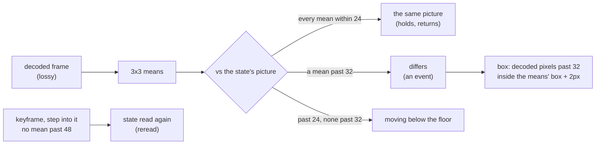

# storyboard noise floor v1 — lossy recordings through a noise band

2026-10-16. `snapshot storyboard --lossy` compares frames decoded from a lossy codec through a
noise band instead of byte for byte. This round covers how the band was chosen, on known answers,
and what it does to real recordings with labels. It also says what it still cannot see.

## Why

`scan video` (2026-10-13) made recordings readable, but the storyboard compared pixels exactly. A
codec does not give back the picture it was given: the same still screen decodes differently from
one frame to the next, most of all at sharp edges and across a keyframe. On the H.264 desktop
recordings of ServiceNow's VideoCUA, 9 of 562 consecutive frame pairs were byte-identical, so the
storyboard reported one change that began at frame 1 and never settled. The labelled-dataset
survey that came before this round found the same on every real recording it tried. So the second
stage of "scan video → storyboard → the agent reads the keyframes" could not be scored on real
video at all.

## Known answers

`fixtures/storyboard/planted-ui.html` plants the kinds of `planted.html` on a page that looks like
an application, so a codec has something to ring around: text in three sizes, a photo-like seeded
texture, a gradient, a table. It also adds four kinds a screen recording shows: a 1px text-field
caret blinking, a digit in 12px text changing (`Items 12` → `Items 13`), a pointer moving, and an
article scrolling 1px a frame. Each was captured lossless on the held clock (61 frames, 640x400),
and its lossless storyboard is the answer. All eleven gave the planted events.

The 18 captures (11 on the UI page, 7 on the plain one) were encoded at 60fps with 14 encodings:

- x264 at crf 18, 23, 28, 35 and 45;
- x264 crf 28 with a keyframe every 10 frames;
- x264 crf 23 at 4:4:4;
- x265 crf 28;
- VP8 as Playwright's recordVideo writes it;
- VP9 at crf 31 and 50, each with a keyframe every 30 frames;
- AV1 (SVT) at crf 35 and 50;
- MJPEG.

Each encoding was decoded by `scan video`, giving 252 cases. A case counts as right only when, event
for event, the lossy storyboard matches the lossless one:

- the same class (a return or a change);
- beginning within 3 frames;
- ending no earlier than a frame before and no more than 12 frames after (a codec blurs a change
  in over several frames).

## What the noise is

Measured between decodes of frames that were byte-identical when captured:

| | raw pixel | 3x3 mean | 4x4 block mean | 8x8 block mean |
|---|---|---|---|---|
| x264 crf 18-35, still text, between keyframes | up to 64 | ~16 | ~9 | ~2-4 |
| x264 crf 28, at a keyframe every 10 frames | 142 | 36 | 26 | 14 |
| VP9 crf 50, at a keyframe | 5 | 3 | | |
| the digit change (signal) | ~148 | ~63 | ~21 | 4-5 |

The ringing is high-frequency, so a 3x3 mean cancels most of it while a glyph change survives. An
8x8 block mean loses the glyph. Single-pair statistics could not choose the band, though: after a
change, VP8's realtime mode keeps refining the picture for several frames, and that refinement
reads as noise between frames the capture had as identical. So the band was chosen by running the
storyboard itself.

## Choosing the band

An experimental copy of the storyboard with a pluggable comparison ran every case under 108 bands:

- radius 0, 1, 2;
- still 4-32;
- floor 8-64.

| Band (radius, still, floor) | Right | What it got wrong |
|---|---|---|
| 1, 12, 32 | 205/252 | fades; crf 45; extra changes at every keyframe of the 10-frame GOP; a slide that never settled at crf 35 |
| 1, 24, 32 | 207/252 | fades; crf 45; the 10-frame GOP's keyframes |
| 1, 24, 48 | 208/252 | fades; crf 45; a spinner read as back after 357° (a near-return within 48) |
| 2, 12, 24 | 195/252 | the digit on four encodings (a 5x5 mean dilutes it) |
| **1, 24, 32, keyframe 48** | **215/252** | fades (28: below the floor) and crf 45 (9: the codec destroyed the content) |

A floor of 48 absorbs keyframes but reads a spinner that has nearly come round as back. So the floor
stays 32, and keyframes get a band of their own. A keyframe that departs from a still state, where
the step into it moves no mean past 48, is the codec re-quantizing the picture: the state is read
again there. That is `reread` in story.json, named in SUMMARY.md.

On the 208 cases outside the two stated limits, all 208 are right.

## Three things the implementation needed

- **A hold is measured from its first frame.** A frame compared only with the one before is within
  the band of it during a ramp slower than the band, and such a ramp was one long hold. A unit test
  plants a ramp of 10 levels a frame for 12 frames. The event begins where the ramp passes the floor
  and settles where the ramp stops.
- **Boxes from the decoded pixels.** The means draw a box wrong both ways: a 1px caret comes out 3px
  wide, and of a glyph's thin strokes only the core passes the floor. The box is now the decoded
  pixels past the floor, inside the means' box grown by twice the radius. Box IoU against the
  lossless box:

  | Event | Before | After (median) |
  |---|---|---|
  | glitch, toast | 0.91-0.93 | 1.00 |
  | caret | 0.33 | 1.00 |
  | digit | 0.13 | 0.57 |

- **Speed.** On a 1920x910 recording, the first version took over ten minutes for 563 frames:

  - each read of a frame's means cost 250ms walking columns, and the 5s look-ahead after every
    event re-read up to 150 frames;
  - running sums in memory order and a division table brought a frame's means down to 75ms;
  - the CLI's frame reader moved from pngjs to the repo's fast PNG decoder (47ms → 26ms);
  - each frame's 16x16 block signature is kept for the whole sequence and answers every comparison
    that only has to learn two frames are apart. That shortcut is sound: a mean of differences is
    never larger than the largest.

  The same storyboard now takes 128 seconds.

## Real recordings

All decoded by `scan video` and storyboarded by the CLI with `--lossy`, with no `--ignore`.

**VideoCUA (ServiceNow)** records human desktop tasks. Each task logs its actions on the video's
timeline (MIT on the dataset card, though the LICENSE file the card links to does not exist). Eight of
its tasks were run, from three of the smallest per-app zips (Conky, GrassGIS, OnlyOffice Forms;
two larger GrassGIS tasks, one at 60fps and 2078x1462, were left out). All are H.264, 30fps; at 1080p, keyframes come every 30 to 158 frames.

| Task | Frames | Size | Time | Events | Clicks and keys followed by an event within 1s | Latency (ms) |
|---|---|---|---|---|---|---|
| Conky 106644 | 563 | 1920x910 | 163 s | 27 | 3/3 | 19, 75, 37 |
| Conky 106653 | 589 | 1920x1080 | 212 s | 21 | (moves only) | |
| Conky 106670 | 146 | 1920x912 | 47 s | 8 | (moves only) | |
| Conky 106687 | 257 | 1918x908 | 87 s | 9 | (moves only) | |
| OnlyOffice 41765 | 587 | 1920x1080 | 279 s | 24 | 3/4 (the fourth at 1033ms) | 833, 500, 433 |
| OnlyOffice 41768 | 506 | 1362x722 | 141 s | 13 | 1/1 | 467 |
| GrassGIS 45264 | 263 | 1920x1080 | 103 s | 7 | 1/1 | 33 |
| GrassGIS 46646 | 163 | 1366x716 | 31 s | 9 | 1/1 | 330 |

- **Every logged click and key is followed by an event:** 9 of 10 within 1s, and the tenth after
  1033ms (an app slow to respond).
- **The labels are actions, not changes, so most events have none.** Only 33 of the 118 events fall
  within 1.5s of an action.
- **The unlabelled events looked at are real changes on screen:**
  - On Conky 106644 they are a terminal's block cursor blinking (12x24 transients), each typed
    character of "conky" appearing (the box stepping right about 11px a letter), the output after
    Enter, and the Conky window refreshing once a second.
  - On OnlyOffice 41768 they are a 2x21px text caret blinking (three transients a second apart), a
    toolbar button's hover and its fade, a selection, and the document view changing (read from
    its sheet).
  - None is codec noise: no whole-frame event lands on a keyframe.
- **No recording needed a keyframe read again.** These keyframes move the means by 4 to 22, inside
  the floor.

**GUI-World website/0** is a student screen recording at 1280x720 (CC BY 4.0 per the dataset README)
with three annotated hover keyframes, frames 72, 122 and 156. It gave 11 events in 76s:

- one begins at frame 75;
- one at frame 107, where the pointer starts moving toward the second hover;
- none within 15 frames of 156, where the hover changes nothing visible.

**Shot-boundary datasets** were run on spans of 25fps broadcast and short-form video:

- RAI 25012: the first 40s, 1001 frames at 640x360.
- AutoShot 42728994306: 863 frames at 720x1280.

On them the storyboard is what it is designed to be, not a shot detector:

| Recording | Cuts | An event begins at | Cuts while the storyboard was in a state | Of those |
|---|---|---|---|---|
| RAI 25012, 0-40 s | 3 | 2 | 2 | 2 |
| AutoShot 42728994306 | 18 | 3 | 1 | 1 |

Every cut reached while the storyboard was in a state begins an event. But inside a shot the
camera and the people move, a change never reaches 100ms of one picture, and it runs on through
the next cut (AutoShot: 5 events for 18 cuts). Scoring shot boundaries would need a different
segmentation (a cut detector, which `ffmpeg -vf scdet` already is); this round does not claim one.

The frames of these recordings stay local. BBC, RAI and AutoShot footage carries no license that
allows publishing it, and none of it is in this repository.

## Limits, said by the output

- **A change smaller than the floor, over a 3x3 mean, is not seen.** A 6% fade (15 levels) was a
  drift in every lossless capture and is nothing in every lossy one. `storyboard-lossy.test.ts`
  holds that, so the limit is stated rather than hidden.
- **A change that small landing on a keyframe the band reads again is absorbed.** SUMMARY.md lists
  every keyframe read again.
- **A keyframe inside an event that never settles is not read again.** An unignored spinner's event
  box gathers a 10-frame GOP's keyframe noise. `--ignore` is the remedy there, as on a lossless
  capture.
- **x264 at crf 45 destroys the content.** The digit change never appears, and frame 1 departs from
  frame 0 as the codec refines its first picture.

## Held by tests

- `packages/vlmkit-judge/src/storyboard.test.ts`, 14 tests:
  - the mean;
  - `still` in `frameDelta`;
  - the grown ignore mask;
  - noise as no event;
  - planted events under noise, with their boxes;
  - the ramp;
  - keyframes read again, and a change on a keyframe that is still a change;
  - a return measured against the re-read picture;
  - refused bands;
  - SUMMARY.md's sentences.
- `src/cli/commands/storyboard-lossy.test.ts`: eight planted kinds through five encodings (x264
  crf 23, x264 crf 28 with a keyframe every 10 frames, VP8 as Playwright records, VP9 crf 50 with a
  keyframe every 30, AV1 crf 50). Each must give the lossless story. It also holds the fade limit,
  and the CLI path: refusal without `--lossy`, the band in story.json, keyframes read again.
- The lossless path is unchanged: the existing storyboard tests pass byte for byte.
