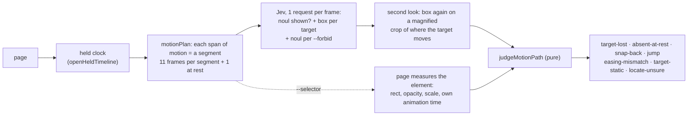

# `inspect motion`: can an agent tell its own CSS animation is visually broken? (2026-10-18)

The goal was a check an agent can run on an animation it just wrote, which says whether the motion
looks broken. The check uses the Jev features already shipped (`box`, `noul`) and knows the answer
for planted defects.

```bash
vlmkit inspect motion page.html --target "the card labelled Users showing 1,284" --selector .card-users \
  --expect-easing ease-out                     # TYPESAFEAI_API_KEY; exit 0 / 1 fail / 2 usage
```



Jev is never asked to name the motion. Asked for an easing, it was at chance (7/21,
`2026-10-18-jev-easing.md`). It is asked where the target is and whether the target can be seen.
The motion is judged from those answers.

## Known answers: `fixtures/motion-defects/`

There are seven mistakes an author makes. Each is an intact page and a broken one that differs by
the mistake. `build.mjs` writes both, and `cases.json` gives the rule a correct check must report.

| case | the mistake |
|---|---|
| snap-back | `animation-fill-mode` missing: the dot returns to the start when the animation ends |
| keyframe-gap | `60%{160px} 61%{40px}`: the card jumps 120px in 1% of the time |
| clipped | the task card moves to the Done column but stays inside an `overflow: hidden` column |
| covered | the dropdown opens under the next card (z-index) |
| overlap-rest | the heading's end keyframe lands it on the paragraph |
| fade-reversed | a fade-in written as a fade-out, held |
| easing-wrong | the spec says ease-out and the CSS says ease-in |

`jev-motion.ts` runs both arms on all 14 pages. It also runs the deterministic gates.

| | broken caught by the expected rule | intact passed |
|---|---:|---:|
| `inspect motion` (description only) | **7/7** | **7/7** |
| `inspect motion --selector` | **7/7** | **7/7** |
| `check animation` (exit code) | 0/7 | 7/7 |
| `check integrity --timeline`, by a rule the intact page lacks | 3/7 (clipped-content, occluded-text, text-collision) | — (exits 1 on both, from container-protrusion / page-overflow-x at mid-motion instants) |

- **Snap-back, keyframe-gap, fade-reversed and easing-wrong are seen by no deterministic gate.** That
  is what `inspect motion` adds.
- **Box centre against the DOM rect's centre**, in frames both call shown: median 4.4px, p90 10.4px
  (n=136), with the second look on a magnified crop. A single look was 7.4px median.
- **Presence against the DOM** (the target topmost at its centre, opacity > 0.3): 161 of 168 frames
  agree. The 7 disagreements sit at the boundaries of fades and clips.
- **Cost:** 478 requests for both arms on 14 pages, $0.061, which is $0.0022 per page per arm.
  About 0.2s per request.

### The overlap statement had to be narrowed, and the change was checked on other data

The claims round's measured wording, "text overlapping other text so that it is hard to read", raised
a false alarm on `covered--intact`, a dropdown legitimately open over the page. The narrower wording
"two lines of text printed on top of each other, their letters crossing" was chosen after that, so it
was validated on the claims round's 54 screenshots, which it was not chosen on
(`jev-motion/overlap-wording.ts`):

| wording | planted overlaps caught | false alarms, clean | false alarms, other plants |
|---|---:|---:|---:|
| "text overlapping other text so that it is hard to read" | 9/9 | 0/9 | 10/36 |
| **"two lines of text printed on top of each other, their letters crossing"** (`DEFAULT_MOTION_FORBID`) | **9/9** | **0/9** | **0/36** |

## What made it work: agents using it on their own pages

The first version already passed the fixtures. Everything that changed afterwards came from fresh
subagents. Each was given only a spec and the tool, and asked to write the animation or repair one,
judge it with the tool, and stop when the tool and the agent's own look at the frames agreed.

| round | task | runs | outcome | what it exposed → fix |
|---|---|---:|---|---|
| 1 | repair: promo card "looks wrong" (keyframe gap) | 2 | fixed, agrees | an easing was named for a path with a jump → none named then |
| 1 | repair: dropdown "looks wrong" (z-index) | 3 | fixed, agrees | `--expect-easing` silently unchecked on a short travel → `easing-unchecked` warn |
| 1 | build: toast slides in, holds 1.5s, exits | 4+ | **never passed; the page was right** | 11 even frames over 2.4s left the entrance 2-3 of them, and hold frames read as a jump's neighbours → **segments**. Boxes cut at the viewport edge → **put back from the target's size**. 12.8px box steps → **magnified second look** |
| 2 | build: the same toast | **1** | passed, agrees | — |
| 2 | build: modal (backdrop + scale/fade) | 3 | **caught the agent's own stray `}`** (dialog rule dropped: text over text at rest) | `?` unexplained → legend. "Not animating at all" was hard to read → `target-static` |
| 2 | build: three staggered stat cards | 5 | **never passed; the page was right** | Jev swapped look-alike cards (630px away and back) → **`locate-unsure`** for off-and-back or shared boxes. **`--selector`**: geometry, opacity, scale and the element's own animation time from the page |
| 3 | build: the same stat cards, with `--selector` | 3 | passed, agrees | a Jev "shown" boxed on another card made a false target-lost → with `--selector`, not rendered = not seen, and a "seen" off the element = unknown |

The rows marked "never passed; the page was right" are the important ones. A self-check that fails a
correct page sends the agent to break correct CSS, and the round-2 stagger agent was told to "add
animation-fill-mode" to cards that already had it. After the fixes, each spec that had failed passed
on the next fresh agent's first or third run, and the round-3 agent agreed with the verdict after
looking at the frames.

## Limits

- **Without `--selector`, presence and position are a model's reading.** Look-alike elements get
  swapped. The tool says so with `locate-unsure` instead of failing, but describe a target by what
  only it shows ("the card labelled Users showing 1,284").
- **Short motions are not fitted.** Under 60px without `--selector`, or 6px / 0.2 opacity / 0.02
  scale with it, there is no easing fit, and an expected easing there is a warn, not a pass.
- **Not judged:** frame rate or jank, a target nobody named, colour animations, the stagger interval
  itself (each sibling's curve is checked, not the 120ms between them), and motion clocks the held
  clock does not hold (see `check animation --virtual-time`).
- **The default statement fires warn-only on a translucent overlay mid-fade.** That is honest:
  both texts are visible for those frames.
- The fixtures are one page each, at 1280x800. The agent rounds are 7 sessions, not a corpus.

Data: `docs/reports/data/2026-10-18-jev-motion/` (`results.json` holds both arms and the gates,
`overlap-wording.json`, and `report.md`). Run `jev-motion.ts --rescore --out <that dir>` to
reproduce the tables with no key.
